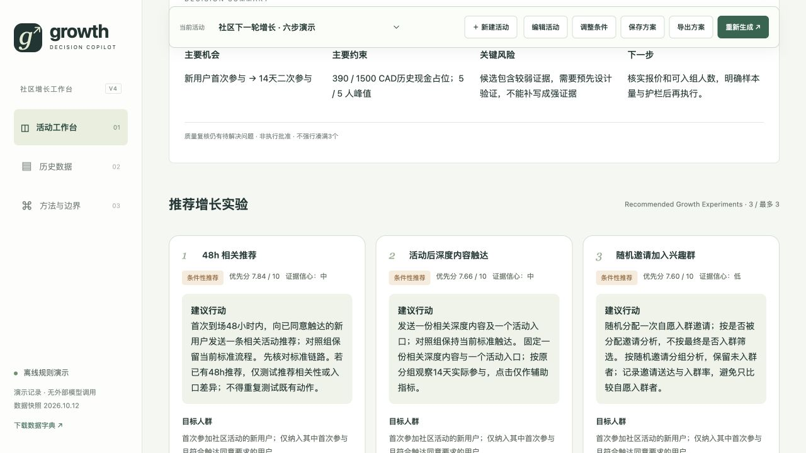

<div align="center">

# AI Growth Decision Copilot

### 帮助社区运营决定：下一轮增长，先试哪几个办法？

输入目标和资源条件，得到值得优先验证的方案、推荐理由与执行前要确认的问题。

[打开在线 Demo](https://growth-decision-copilot.netlify.app/) · [看使用例子](#example) · [了解判断流程](#workflow) · [查看技术实现](#technical)

</div>

---

## 解决什么问题？

办完一场活动，运营团队希望新用户愿意再来。可以做的事情很多：推荐下一场活动、邀请加入兴趣群、推送相关内容、人工跟进，或提供优惠。

但预算和人手有限，不能把所有办法同时做一遍。历史上效果最好的办法，也可能成本太高；看起来参与率更高的人群，也可能本来就更有兴趣。

**这个产品帮助团队把想法变成可以比较、值得验证的实验，回答三个问题：**

- **先做什么？** 选出当前条件下优先考虑的方案。
- **为什么？** 展示依据、资源取舍，以及其他方案未入选的原因。
- **还缺什么？** 列出样本、成本、隐私或执行安排中需要确认的事项。

目标用户是负责社区活动、新用户运营和留存的运营人员。当前版本聚焦一个具体目标：**让首次参加活动的用户，在14天内再次实际参加活动。**

> **版本说明：** 这是可以操作的产品 Demo，目前用固定案例和明确规则演示决策过程，没有接入大模型。更完整的 AI 工作流已完成设计，尚未实现的部分在后文单独列出。

<a id="example"></a>

## 一个具体的使用例子

假设团队有 **CAD 1,500预算、5名核心执行人员和4周时间**，想提高新用户二次参与。

运营人员可以先生成建议，再把本轮最多实验数设为2。在当前演示规则下，未排除已有策略且其他条件允许时，会优先保留：

| 方案 | 准备验证什么 | 为什么值得考虑 | 执行前要确认什么 |
|---|---|---|---|
| 48小时内推荐相关活动 | 及时提供下一场活动入口，是否有助于用户再次参与 | 历史案例有正向信号，资源投入较低 | 现有流程是否已经这样做？本次新增的变化是什么？ |
| 活动后发送相关深度内容 | 延续用户兴趣，是否能带来实际再次参与 | 历史现金成本较低，适合小规模验证 | 点击是否转化为实际参与？有多少用户可以入组？ |

这两个方案的历史资源参考合计为 **CAD 270、20人时、并行峰值3人**，不是未来执行报价，也不代表已经证明有效。

把预算降低，或将其中一项勾选为“已经实施”，推荐会重新计算。**推荐结果取决于条件，不是固定展示三个答案。**

## 打开之后怎么用？

1. **填写任务**：选择单场活动或社区整体增长，设置人群、预算、人力及已有策略。
2. **查看建议**：首页直接给出推荐名称、资源参考和下一步。
3. **核对理由**：查看每个方案的证据、风险和验证计划；需要时展开详细过程。
4. **调整并保存**：修改条件后重新生成，将方案保存到浏览器或导出报告。

**[立即体验 Demo →](https://growth-decision-copilot.netlify.app/)** 无需配置模型密钥。



页面遵循一个顺序：**先告诉用户该做什么，再解释为什么，最后允许用户检查判断过程。**

<a id="workflow"></a>

## 它如何得出建议？

产品将决策分成六个步骤，让“提出想法”和“判断想法是否值得做”分别接受检查。

| 步骤 | 用普通话解释 | 流程图中的名称 |
|---|---|---|
| 1. 提出方案 | 围绕业务目标，列出可尝试的办法 | Generation |
| 2. 检查重复 | 避免多个方案只是同一个想法换了说法 | Diversity Check |
| 3. 找出问题 | 检查证据是否可靠、资源是否足够、会不会打扰用户 | Reflection |
| 4. 比较优先级 | 综合潜在效果、证据、成本和风险，判断先考虑哪个 | Ranking |
| 5. 改进方案 | 根据发现的问题，补充或修改执行与验证设计 | Evolution |
| 6. 重新比较 | 用同样的标准评价改进版，判断是否值得保留 | Re-ranking |

之后还有两层检查：

- **质量检查（Quality Gate）**：识别证据不足、排序接近或没有可行方案等问题。必要时最多再复核一轮；仍解决不了的事项继续保留。
- **综合复核（Meta-review）**：总结共同机会、风险、数据缺口，以及为什么优先这些方案。只解释结论，不另造方案或改变排序。

**改进方案不等于获得新证据。** 例如，把人工跟进改成更明确的执行计划，并不能证明它更有效。产品不会仅因为修改了文字，就自动提高证据分。

<details>
<summary><strong>查看完整流程图与设计说明</strong></summary>

[](flow%20chart.png)

点击图片可以放大。此图描述目标设计，编号主流程以六步为准；综合复核是之后补充在质量检查与最终输出之间的步骤。图中涉及的独立Agent协作、语义检查等能力，尚未全部实现。

Evolution指执行前改进方案。活动结束后回填结果、让下轮决策使用新证据，是另一个后续功能。

</details>

## 推荐时，如何做取舍？

演示版使用六项评价：可能带来多大改善、依据有多可靠、是否符合目标、是否做得出来、成本负担如何、风险是否可控。

高分不能绕过预算、人力或风险限制。即使一个方案观察到的效果最好，也可能因为人力投入太高而暂不推荐。证据薄弱的方案则必须明确说明不确定性。

**输出的是“优先验证的建议”，不是“保证有效的答案”或自动执行批准。** 条件不足时，允许少于三个方案，也允许没有推荐。

## 现在能做什么，还不能做什么？

| 已经可以体验 | 尚未实现 |
|---|---|
| 新建任务，调整资源和已有策略 | 根据任意业务描述，由大模型生成全新方案 |
| 查看推荐、评分、证据与风险 | 多个独立AI角色真实调用与协作 |
| 比较方案改进前后，查看综合复核 | 导入任意业务数据并自动理解口径 |
| 保存到当前浏览器，导出决策报告 | 登录账户、跨设备同步、团队协作 |
| 用明确规则演示完整判断流程 | 执行实验、回填结果、持续更新证据 |

页面刷新后可从当前浏览器恢复保存的任务，但数据不会自动同步给其他人。当前Demo没有自动学习、模型训练或自动发送营销消息的功能。

## 项目从哪里来？

项目源于“体验获客 → 社群沉淀 → 深度内容 → 会员留存”的社区运营经历。作者确认的业务统计为：新用户14天二次参与率由约18%提升至约31%，相对变化约72%，即“约70%”。

在已有优化基础上，新的问题是：哪些做法仍值得继续验证，哪些投入开始不划算？这个作品围绕这一决策问题展开。**历史业务成果不是由本Demo创造的。**

演示包含800名用户、24场活动、72条内容和8个历史实验。CSV逐行记录是根据业务统计生成的演示记录，不是逐条核验或脱敏后的业务原始数据；观察差异也不能直接当作因果效果。详见[数据字典](ai-growth-decision-copilot-demo/dist/data/README.md)。

<a id="technical"></a>

## 想了解技术实现？

当前实现是纯浏览器应用：页面收集输入，JavaScript规则计算推荐，浏览器本地存储保存任务。没有服务端模型调用，无需API密钥。

<details>
<summary><strong>展开实现细节、评分方法与运行方式</strong></summary>

| 环节 | 当前实现 | 目标设计 |
|---|---|---|
| 生成与去重 | 8个案例模板；精确匹配与预定义机制分组 | 动态生成、语义相似度检查 |
| 审查 | 按字段检查样本、研究设计、资源与风险 | 多视角模型审查及外部证据检索 |
| 排序 | 六维加权分及同一分数的两两比较 | 独立评审的两两对阵与稳定性分析 |
| 改进与复评 | 对初排前三项补充计划，按原规则重算 | 生成新变体并重新估算资源 |
| 质量与总结 | 最多一轮规则复核；四项结构化总结 | 定向Agent调度与模型综合复核 |

默认权重：影响潜力25%、证据强度20%、业务价值20%、可行性15%、成本效率10%、风险可控性10%。风险可控性分越高，表示风险越低。评分公式是演示选择，没有经过效果预测校准；当前业务价值统一评分，现金成本也不等于投资回报。

源码位于 `ai-growth-decision-copilot-demo/dist/`。下载后进入项目目录：

```sh
cd ai-growth-decision-copilot-demo
python3 -m http.server 8765 --directory dist
```

安装Node.js后，可在同一目录运行：

```sh
npm test
```

修改源码后，重新生成离线版：

```sh
python3 scripts/build_standalone.py
```

无需启动服务器时，直接用浏览器打开该目录下的 `index.html` 即可。

当前23项自动检查通过，覆盖数据口径、资源约束、保存恢复、迭代次数及综合复核。主要浏览器交互已核对；尚未开展正式用户研究或完整跨设备测试。

</details>

## 进一步阅读

- [架构与职责](ai-growth-decision-copilot-demo/docs/ARCHITECTURE.md)：各步骤接收什么、输出什么。
- [当前实现](ai-growth-decision-copilot-demo/docs/IMPLEMENTATION.md)：规则、评分公式和边界。
- [Agent设计草案](ai-growth-decision-copilot-demo/docs/AGENT_PROMPTS.md)：后续模型角色的提示词设计。
- [后续规划](ai-growth-decision-copilot-demo/docs/ROADMAP.md)：未实现功能及验收标准。

---

本项目使用AI辅助实现，展示业务问题分析、产品设计与可交互原型。当前可运行能力和未来规划分别说明。
