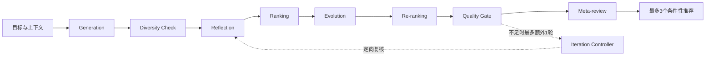

# AI Growth Decision Copilot

**帮助社区运营回答：在有限预算和人力下，下一轮最值得验证哪些增长实验？**

一个面向社区运营的交互式产品作品。完整呈现多 Agent 决策流程的产品设计；当前可运行版本使用透明规则与固定模板，不调用大模型。


## 产品背景

项目源于“体验获客 → 社群沉淀 → 深度内容 → 会员留存”的业务问题。项目作者确认的业务背景为：新用户14天二次参与率从约18%到约31%，相对变化约72%，对应“约70%”的业务表述。

本项目关注下一阶段：已有链路优化之后，如何比较新策略的影响潜力、证据强度、资源成本及风险，避免简单重复已有动作。历史业务成果不归因于这个Demo。

**数据说明：** 本仓库是基于真实业务统计构建的演示数据；CSV逐行记录由程序生成，未与实际业务记录逐条核验，并非脱敏原始数据。前后观察及历史组间差异不直接证明因果。

## 体验

- 下载本仓库，直接用浏览器打开根目录 `index.html`，无需密钥或安装依赖。
- 可将根目录 `index.html` 单独发布到 Netlify，生成可分享链接。
- 在线体验地址由作者在仓库右侧 About → Website 中填写，以 Netlify 当前发布地址为准。

建议先生成示例推荐，再修改预算或标记“已实施策略”，观察推荐、解释和质量检查如何变化。

## 用户体验

1. 创建单场活动或社区整体增长任务，输入人群和资源条件。
2. 首页直接展示“本轮优先做什么”、实验名称、资源参考和执行前条件。
3. 推荐卡片解释行动、证据、成本、风险和验证方式。
4. 查看六维比较和Meta-review；需要时展开完整流程。
5. 保存到当前浏览器，或导出JSON/Markdown决策记录。

## 设计流程



Evolution指执行前改进方案；实验结束后的结果回填属于后续扩展，不是Evolution的替代。

## 已实现与规划

| 能力 | 当前Demo | 后续设计，尚未实现 |
|---|---|---|
| Generation | 8个案例模板与上下文关联 | 大模型动态生成5–8个假设 |
| Diversity | 精确去重、预定义机制分组 | 语义相似度与跨人群多样性 |
| Reflection | 证据、资源、隐私、体验等字段规则 | 多视角模型审查、必要时检索外部证据 |
| Ranking | 六维启发式加权分与两两分差比较 | 独立裁判的pairwise tournament |
| Evolution | 前三候选补充执行及验证计划 | 结合批评生成新变体并重估资源 |
| Re-ranking | 同一规则重算，保留V1/V2对比 | 独立复评与排名稳定性评估 |
| Quality Gate / Iteration | 三类触发条件，最多一轮规则复核 | 更全面门槛与定向Agent调度 |
| Meta-review | 四字段规则汇总，不改排序 | 基于过程证据的模型综合复核 |
| 保存 | 当前浏览器与报告导出 | 账户、云端存储、结果回填 |

没有自动执行实验、在线学习或模型训练功能。评分是可解释的演示判断，不是经过校准的效果预测。

## 关键产品取舍

- 推荐优先，流程按需展开：用户先看到行动，再追溯依据。
- 六维默认权重：Impact 25%、Evidence 20%、Business Value 20%、Feasibility 15%、Cost Efficiency 10%、Risk Safety 10%。高风险可控性分表示风险较低。
- 保留观察性偏差、小样本和未知报价；不因为修改方案文字就提高证据分。
- Top 3是上限；资源不够时允许推荐更少甚至零个。
- Meta-review只总结，不产生新假设、不重新排序、不绕过硬性限制。

## 演示数据

800用户（New 280 / Active 240 / Loyal 160 / Dormant 120）、24活动、72内容、8历史实验。组织20人、核心团队5人；预算CAD 1,500，4周窗口、14天观察、最多并行3个实验；低工程投入、保守隐私约束。

详细字段见 [数据字典](dist/data/README.md)。

## 本地开发与验证

源文件位于 `dist/`。使用Python静态服务器预览：

```sh
python3 -m http.server 8765 --directory dist
```

随后访问本机8765端口。安装Node.js后运行测试（无需第三方依赖）：

```sh
npm test
```

当前23项自动检查通过，覆盖数据口径、硬约束、保存恢复、有限迭代和Meta-review。浏览器已核对主要交互；尚无正式用户研究或跨设备完整测试结果。

修改 `dist/` 后，根目录离线版不会自动更新；可用 `python3 scripts/build_standalone.py` 重新生成。

## 项目文件

- `index.html`：可直接打开的离线Demo。
- `dist/`：HTML、CSS、JavaScript及演示数据。
- `tests/`：可执行验证。
- [架构与职责](docs/ARCHITECTURE.md)
- [Agent提示词设计草案](docs/AGENT_PROMPTS.md)
- [后续路线与验收标准](docs/ROADMAP.md)
- [当前实现细节](docs/IMPLEMENTATION.md)

本项目使用AI辅助实现。仓库展示产品设计、可交互原型及实现边界，不将规划中的能力描述为已上线功能。
